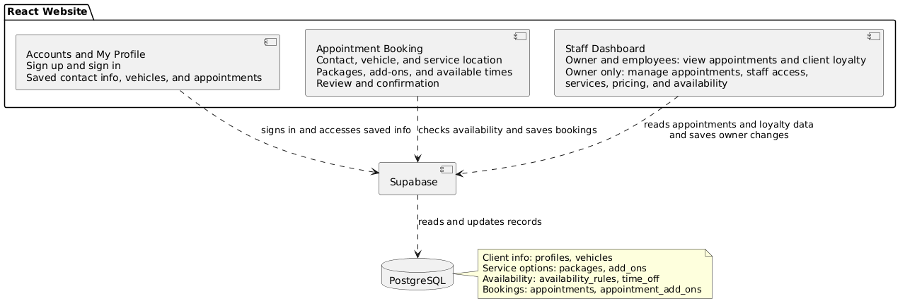

#Sprint 1 Planning
# Task 1: Select Sprint 1 User Stories

## Selected User Stories

**User Story 1: (Collect Client Info)**  
As a mobile small business owner, I want to collect and store client contact information, so that I can contact clients and reach the location of the job.

**User Story 2: (Collect Car Details)**  
As a mobile small business owner, I want to collect and store client car information, so that I can use that information to inform my job plan.

**User Story 13: (Accounts/Log In w/ Saved Info)**  
As a client, I want to log in and have my info saved so booking is faster next time.

**User Story 14: (Admin/Client Account Separation)**  
As the owner, I want separate staff logins and a view of repeat clients so I can recognize loyal customers and safely give employees dashboard access.

## Rationale

These were chosen because they provide a logical foundation of fundamental features to build on, while also keeping the first sprint manageable. This gives our team time to set up the project and gain experience with the sprint process before tackling the more complicated user stories.

## Distribution of Work

**Zeke** will set up the database via Supabase. **Lily** will set up the React project with clear labels and comments. **Zeke** and **Lily** will then handle the account-related user stories (13 and 14).

**Finch** and **Jakub** will work on user stories 1 and 2, which will require setting up the front end to collect input as well as storing the details in the database.

# Task 2: Use Case Diagram

  This task has been uploaded as Use Case Diagram.png for ease of referencing.

# Task 3: Software Design

 1. Class Diagram (Structural Design)
   uploaded as ClassDiagram.png in repository

 3. Sequence Diagram (Behavioral Design)

# Sprint 1 Conclusion
# SPRINT RETROSPECTIVE -- We Messed Up
Messing up is part of the process as long as we review and do better next time... Right...? Whoops. 
Sprint 1 was a learning curve. We followed the branching and pull request guidelines inconsistently at first, but by the end we had a clearer understanding of how to use them in future sprints. In our sprint retrospective, we discussed creating the Markdown document before we begin work and breaking down the rubric together so everyone has a much clearer understanding from the beginning of what procedures need to be followed, and a clearer understanding of not just the larger tasks but also the smaller pieces that need to be done, such as reviews and comments.

# UML Diagram

Created using PlantText. We chose a client-server architecture, because our software’s goal is to collect and store data about users and appointments, from various devices. While multiple pages may make up each component, the React website should be seen as having three main components: Accounts, Booking, and Staff Dashboard. Accounts features should handle sign-in and saving user information. Appointment Booking should guide clients through choosing, while storing, appointment related data. The Staff Dashboard should give employees and the owner special access to data about client loyalty and the ability to do necessary business management like editing appointment data and user roles. For the server, we use Supabase to access the same PostgreSQL database, giving us a secure, shared backend.

# Task 4: Sprint 1 Planning and Task Breakdown

Complete in project.
