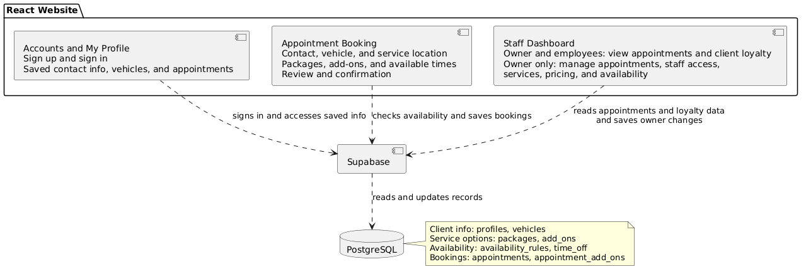

# SPRINT RETROSPECTIVE -- We Messed Up
Messing up is part of the process as long as we review and do better next time... Right...? Whoops. 
Sprint 1 was a learning curve. We followed the branching and pull request guidelines inconsistently at first, but by the end we had a clearer understanding of how to use them in future sprints. In our sprint retrospective, we discussed creating the Markdown document before we begin work and breaking down the rubric together so everyone has a much clearer understanding from the beginning of what procedures need to be followed, and a clearer understanding of not just the larger tasks but also the smaller pieces that need to be done, such as reviews and comments.

# UML Diagram

Created using PlantText. We chose a client-server architecture, because our software’s goal is to collect and store data about users and appointments, from various devices. While multiple pages may make up each component, the React website should be seen as having three main components: Accounts, Booking, and Staff Dashboard. Accounts features should handle sign-in and saving user information. Appointment Booking should guide clients through choosing, while storing, appointment related data. The Staff Dashboard should give employees and the owner special access to data about client loyalty and the ability to do necessary business management like editing appointment data and user roles. For the server, we use Supabase to access the same PostgreSQL database, giving us a secure, shared backend.

Finch Gerwe 
Developer/SCRUM Master 
User Story 1, issues #42 and #43, started issue #44 
Contribution: 25%

Zeke Grant 
Developer 
Supabase setup and internal connections, User Story 13 work 
Contribution: 25%

Lily Kate McConnell 
Developer/Project Owner 
Made the React project with a temporary navigation and pages, created CODEGUIDE.md to help others understand React, helped connect project the database, completed the UML Diagram, recorded retrospective notes, and user story 14 work.  
Contribution: 25%

Jakub Nowicki 
Developer 
User Story 2, issues #45, #46 and #47  
Contribution: 25%
